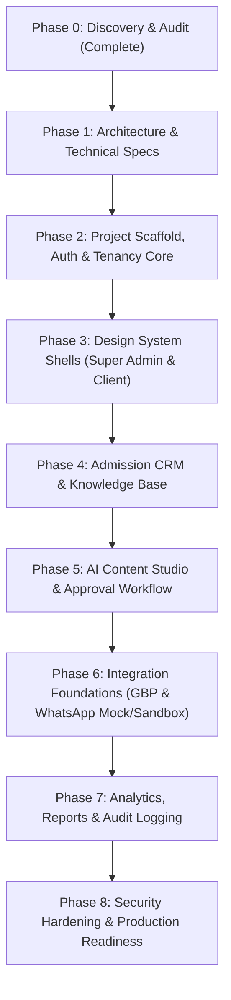

# GrowthMantra AI — Repository Audit & Discovery Report

**Product:** GrowthMantra AI  
**Owner:** The Marketing Mantra  
**Date:** 08 November 2026  
**Auditor:** Antigravity AI Pair Programmer  
**Specification Reference:** `GrowthMantra_AI_Antigravity_Full_Plan.md` (v1.0)  

---

## 1. Executive Summary

A comprehensive repository inspection was conducted on the working directory `c:\Users\LAKSHAY\Downloads\GROWTH MANTRA AI`.

* **Repository State:** Clean slate / Greenfield. The workspace folder was completely empty (no previous commits, legacy dependencies, or partial scaffolding).
* **System Environment:** Windows 11 host with modern Node.js (`v24.16.0`), npm (`11.13.0`), Bun (`1.3.14`), Python (`3.14.5`), and Git (`2.56.0`). PHP, Composer, and Docker are **not** installed on this host.
* **Architectural Alignment:** The product plan recommends Next.js (App Router + TypeScript) for frontend and either Laravel or a unified modern TypeScript service backend. Given the host runtimes (Node.js 24 + Bun + TypeScript native, without PHP/Composer/Docker), building on a Next.js 15+ App Router full-stack architecture (with Prisma or Drizzle ORM, PostgreSQL, Server Actions / Route Handlers, and robust service adapters) offers immediate zero-friction execution, maximum type safety across client and server, and complete compliance with all product principles.

---

## 2. Frameworks, Runtime Versions & Package Managers

### Detected on Host System
| Tool / Runtime | Version | Status | Notes |
|---|---|---|---|
| **Node.js** | `v24.16.0` | Active | Modern LTS-tier runtime |
| **npm** | `11.13.0` | Active | Invoked via `npm.cmd` (PowerShell script execution policy safe) |
| **Bun** | `1.3.14` | Active | High-speed bundler, package manager, and test runner |
| **Python** | `3.14.5` | Active | Available for data utilities or tooling scripts |
| **Git** | `2.56.0.windows.3`| Active | Version control ready |
| **PHP / Composer**| Not Found | Inactive | Not installed on system PATH |
| **Docker** | Not Found | Inactive | Not installed on system PATH |
| **PostgreSQL CLI (`psql`)**| Not Found | Inactive | PostgreSQL instance to be provisioned (local service or managed cloud) |

---

## 3. Directory Structure, Entry Points & Routes

* **Current State:** Empty directory (`0` files prior to audit initialization).
* **Target Layout:**
```text
growthmantra-ai/
├── apps/
│   └── web/                   # Next.js App Router (TypeScript, Tailwind CSS, Lucide icons)
│       ├── src/
│       │   ├── app/           # App Router routes (admin, client, auth, api/v1)
│       │   ├── components/    # Reusable design system UI components
│       │   ├── lib/           # Adapters, db client, auth, validation schemas
│       │   ├── hooks/         # Client hooks
│       │   └── types/         # Domain TypeScript interfaces
├── docs/                      # Architectural and API specifications
│   ├── ARCHITECTURE.md
│   ├── DATA_MODEL.md
│   ├── API_CONTRACTS.md
│   ├── SECURITY_CHECKLIST.md
│   └── IMPLEMENTATION_ROADMAP.md
├── prisma/ or db/             # Schema definitions and database migrations
├── .env.example               # Sanitized environment variable template
├── AGENTS.md                  # Strict engineering guidelines
└── REPO_AUDIT.md              # Discovery baseline report (this file)
```

### Planned Route Structure
* **Public / Auth:** `/login`, `/forgot-password`, `/reset-password`
* **Super Admin Portal:** `/admin/overview`, `/admin/clients`, `/admin/branches`, `/admin/team`, `/admin/approvals`, `/admin/integrations`, `/admin/ai-usage`, `/admin/plans`, `/admin/audit-logs`, `/admin/settings`
* **Client / Preschool Workspace:** `/dashboard`, `/leads` (Kanban & Table), `/whatsapp` (Shared Inbox), `/gbp` (Google Profile & Posts), `/seo` (Local SEO Audit), `/studio` (AI Content Studio), `/calendar` (Content Calendar), `/approvals` (Human Approval Centre), `/reports`, `/knowledge-base` (Preschool Verified Facts), `/settings`
* **API Endpoints (`/api/v1`):** RESTful JSON endpoints with tenant and branch scoped authorization.

---

## 4. UI Components, API Endpoints & Database Schema

* **Existing Components:** None.
* **Component System to Scaffold:**
  - `AppShell`, `Sidebar`, `Topbar`, `BranchSwitcher`, `PageHeader`
  - `StatCard`, `ChartCard`, `DataTable`, `FilterBar`, `StatusBadge`
  - `EmptyState`, `LoadingSkeleton`, `ConfirmDialog`, `Toast`
  - `LeadKanban`, `LeadDrawer`, `ActivityTimeline`
  - `ApprovalCard`, `ApprovalTimeline`, `ContentEditor`, `ContentPreview`, `CalendarGrid`
  - `ConversationList`, `MessageThread`, `Composer`
  - `IntegrationCard`, `KnowledgeFactCard`
* **Database Schema:** 18 domain models specified in Section 7 of the product plan (`tenants`, `branches`, `users`, `roles`, `permissions`, `tenant_users`, `branch_users`, `business_facts`, `integrations`, `oauth_tokens`, `content_items`, `content_versions`, `approvals`, `contacts`, `leads`, `lead_activities`, `conversations`, `messages`, `audit_logs`).

---

## 5. Authentication & Authorization Strategy

* **Authentication:** Secure session cookies (HTTP-only, SameSite, Secure) with bcrypt/argon2 password hashing, optional TOTP MFA, and session revocation.
* **Tenancy & Scoping:**
  - Multi-tenant from day one.
  - Strict resource-level authorization: every database query checks `tenant_id` and assigned `branch_id`.
  - Client-supplied `tenant_id` or `branch_id` is never trusted.
* **Roles (RBAC):**
  1. `Super Admin`: Full cross-tenant management.
  2. `Agency Admin / Manager`: Assigned tenants.
  3. `Preschool Owner`: Own tenant only (all branches).
  4. `Branch Manager`: Assigned branches only.
  5. `Admission Counsellor`: Assigned leads / branches only.
  6. `Content Reviewer`: Content review and approval decisions.

---

## 6. Environment Variables (Names Only)

Zero secrets stored or exposed. The required variables based on Section 15:
- `APP_NAME`, `APP_ENV`, `APP_URL`, `FRONTEND_URL`, `APP_SECRET`
- `DATABASE_URL` (PostgreSQL connection string)
- `REDIS_URL` (Redis cache / queue connection string)
- `OPENAI_API_KEY`, `OPENAI_MODEL`
- `GOOGLE_CLIENT_ID`, `GOOGLE_CLIENT_SECRET`, `GOOGLE_REDIRECT_URI`, `GOOGLE_BUSINESS_PROFILE_ENABLED`
- `META_APP_ID`, `META_APP_SECRET`, `WHATSAPP_ACCESS_TOKEN`, `WHATSAPP_PHONE_NUMBER_ID`, `WHATSAPP_BUSINESS_ACCOUNT_ID`, `WHATSAPP_WEBHOOK_VERIFY_TOKEN`
- `S3_ENDPOINT`, `S3_BUCKET`, `S3_ACCESS_KEY`, `S3_SECRET_KEY`, `S3_REGION`

---

## 7. Build, Test, Lint & Migration Commands

Upon initial scaffolding with Next.js/TypeScript/Bun/npm:
- **Dev:** `npm run dev` or `bun dev`
- **Build:** `npm run build`
- **Lint:** `npm run lint`
- **Typecheck:** `npx tsc --noEmit`
- **Test:** `npm test` / `bun test`
- **Migrations:** `npx prisma migrate dev` / `npx prisma db push`

---

## 8. Reusable Assets, Missing Prerequisites & Risks

### Reusable Assets Found
1. `GrowthMantra_AI_Antigravity_Full_Plan.md`: Exhaustive functional & technical specification.
2. Sibling Brand Assets in `c:\Users\LAKSHAY\Downloads`:
   - `Delhi Preschool Growth Offer.png`
   - `Digital Marketing Growth Blueprint.png`
   - `Preschool Marketing Growth Sprint in Noida.png`
   - `GrowthMantra_AI_Premium_Proposal.pdf`
   - `GrowthMantra_AI_Proposal_The_Marketing_Mantra.pdf`

### Missing Prerequisites
1. **Database:** PostgreSQL database instance (local or managed cloud instance like Neon / Supabase / ElephantSQL).
2. **API Credentials:** OpenAI API key, Google Cloud OAuth Client credentials for GBP, and Meta WhatsApp Business credentials for live integration phases.
3. **Storage:** S3-compatible bucket credentials for media uploads.

### Critical Risks & Guardrails
1. **Premature Integration Claims:** Third-party APIs (Google GBP, Meta WhatsApp) will remain flagged as `Not connected / Configuration required` until authentic API access, scopes, and end-to-end verification are completed.
2. **AI Hallucinations:** AI Content Studio prompt pipelines must strictly draw from verified `business_facts`. If facts are missing, the system outputs `needs_human_input: true`.
3. **Approval Bypass Prevention:** Content publishing jobs must verify approval immutability immediately before calling external APIs. Editing approved content creates a new version and reverts status to `draft`.
4. **Data Privacy (DPDP Act Compliance):** Parent contact information and child age bands must be protected with tenant-scoped encryption, strict RBAC export controls, and zero leakage to AI prompts.

---

## 9. Phased Implementation Roadmap



### Next Immediate Step (Phase 1: Technical Design Documentation)
Generate the required documentation suite in `docs/`:
- `docs/ARCHITECTURE.md`
- `docs/DATA_MODEL.md`
- `docs/API_CONTRACTS.md`
- `docs/SECURITY_CHECKLIST.md`
- `docs/IMPLEMENTATION_ROADMAP.md`
